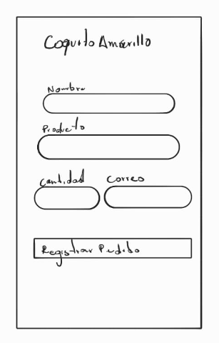

# Sistema de pedidos — Coquito Amarillo S.A.S.

## Descripción
Aplicación web que registra pedidos en Datos.csv y en MySQL.

### Diseño de la Interfaz


## Requisitos
- Node.js (LTS)
- MySQL 8 (o XAMPP)
## Instalación
1. Clonar el repositorio y entrar a la carpeta:
   ```bash
   git clone https://github.com/pablormrz/coquito-amarillo.git
   cd coquito-amarillo
   ```
2. Instalar dependencias:
   ```bash
   npm install
   ```
3. Importar la base de datos:
   ```bash
   mysql -u root -p -e "source database/script.sql"
   ```
4. Si tu MySQL tiene contraseña, edítala en `CONFIG_BD` de `servidor.js`
## Ejecución
1. **Asegurar que MySQL esté en ejecución:**
   - Si usas **XAMPP**: Abre el *Panel de Control de XAMPP* y presiona **Start** en el módulo **MySQL**.
   - Si usas **MySQL Workbench / Servicio de Windows**: Verifica que el servicio de MySQL esté iniciado.
2. **Iniciar el servidor:**
   ```bash
   node servidor.js
   ```
3. **Acceder a la aplicación:**
   - Abre tu navegador web en [http://localhost:3000](http://localhost:3000)
## Estructura
```text
coquito-amarillo/
├── capturas/               # Evidencias y capturas de pantalla de la ejecución
│   ├── Consola ServidorJS.png
│   ├── Diseño.png
│   ├── Envío Exitoso.png
│   ├── Fomulario Lleno.png
│   └── Registros MySQL.png
├── database/               # Scripts para la base de datos
│   └── script.sql          # Creación de la base de datos y tabla
├── public/                 # Archivos estáticos del frontend
│   ├── app.js              # Lógica del cliente y envío al servidor (Fetch API)
│   ├── estilos.css         # Hoja de estilos con diseño en tonos pastel
│   ├── formulario.html     # Estructura del formulario web
│   └── logo.svg            # Logo y favicon de coco amarillo
├── Datos.csv               # Almacenamiento plano de los registros
├── package.json            # Metadatos del proyecto y dependencias
├── package-lock.json       # Árbol exacto de dependencias instaladas
├── README.md               # Documentación general del proyecto
└── servidor.js             # Servidor Express, lógica POO y repositorios
```
## Decisiones de diseño

### 1. Arquitectura y Backend (POO y Persistencia)
- **Encapsulamiento e integridad de datos (`RegistroPedido`):**
  - Uso de campos privados (`#nombreCliente`, `#producto`, `#cantidad`, `#correo`, `#fecha`) con métodos *getters* para proteger el estado del objeto y evitar modificaciones indebidas.
  - Método estático `validar(datos)` para centralizar y aplicar reglas de validación (campos obligatorios, límites de caracteres, cantidades enteras positivas y expresión regular para formato de correo electrónico) antes de procesar el registro.
  - Método `toCSV()` con saneamiento y escape de comas/comillas según estándar para no corromper la estructura del archivo plano.

- **Patrón Repositorio y Herencia (`Repositorio`, `RepositorioCSV`, `RepositorioMySQL`):**
  - Implementación de una clase base abstracta `Repositorio` para desacoplar la capa de persistencia del controlador HTTP Express.
  - Subclase `RepositorioCSV` para escritura incremental (`appendFile`) sin sobreescribir el historial y asegurando encabezados en la creación inicial.
  - Subclase `RepositorioMySQL` usando *pool* de conexiones (`mysql2/promise`) y consultas preparadas con parámetros (`?`) para prevenir inyecciones SQL.

- **Persistencia Concurrente (`Promise.allSettled`):**
  - Permite guardar en MySQL y en el archivo CSV de forma paralela sin que el bloqueo de un medio detenga al otro, capturando errores de forma granular para informar al cliente exactamente qué destino tuvo inconvenientes.

### 2. Frontend y Experiencia de Usuario (UI / UX)
- **Comunicación asíncrona (Fetch API):**
  - Envío del formulario mediante AJAX (`fetch`), previniendo la recarga de página (`event.preventDefault()`) para brindar retroalimentación inmediata sin interrumpir la navegación.

- **Paleta de colores pastel:**
  - Selección de una gama cromática suave y equilibrada (amarillo pastel `#FFF3CD` / `#F5D98E`, crema `#FFFBF0`, lila `#E2D4F0` y rosa `#FFD6E0`) que refleja la identidad de "Coquito Amarillo" de manera amigable y moderna.

- **Identidad de marca y Logo SVG:**
  - Creación de un isotipo vectorial escalable (`logo.svg`) representando un coco amarillo partido a la mitad con detalles de pulpa y textura. Se implementó tanto en la cabecera junto al título como en el `favicon` de la pestaña del navegador para una identidad visual consistente.

- **Estilo Glassmorphism y Microinteracciones:**
  - Uso de tarjeta con efecto de vidrio esmerilado (`backdrop-filter: blur`), elementos flotantes de fondo animados (`keyframes`), bordes suaves y efectos visuales de interacción (*hover*, estados de foco con sombras luminosas y avisos dinámicos de éxito o error).

- **Diseño responsivo y tipografía moderna:**
  - Implementación de fuente web legible (*Outfit*) y diseño adaptable para garantizar una visualización óptima tanto en computadores como en dispositivos móviles.